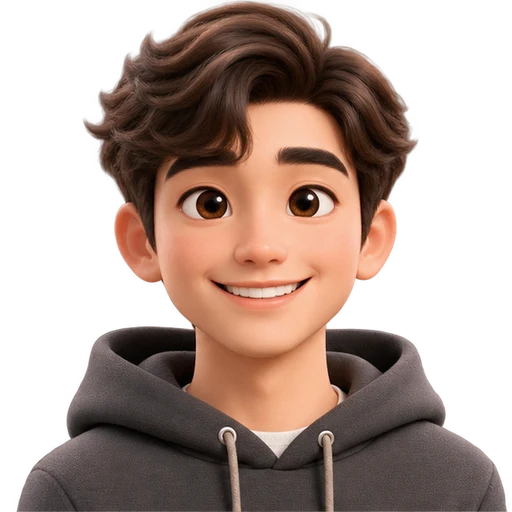
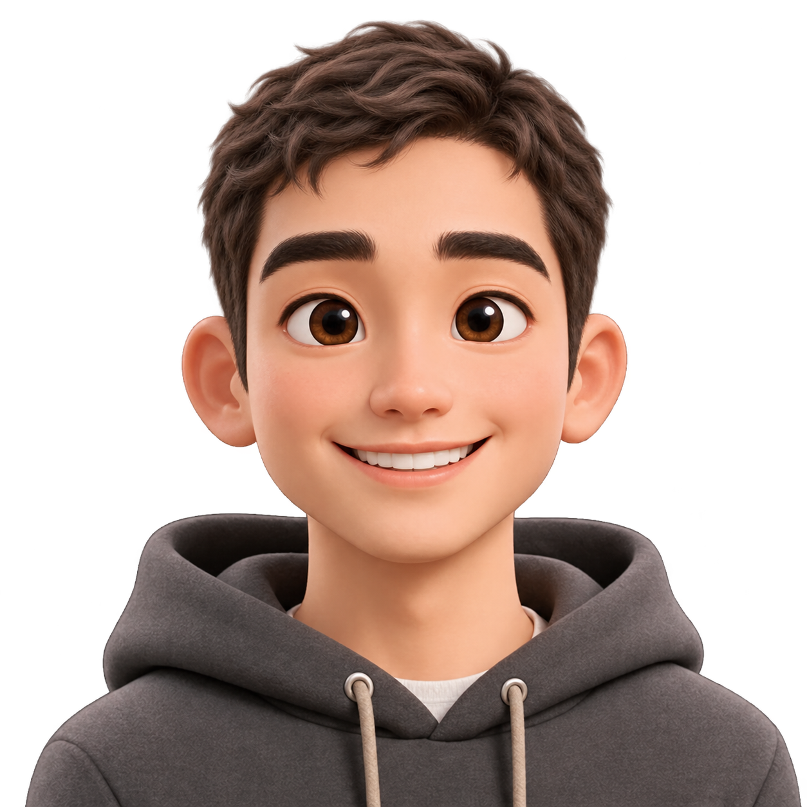
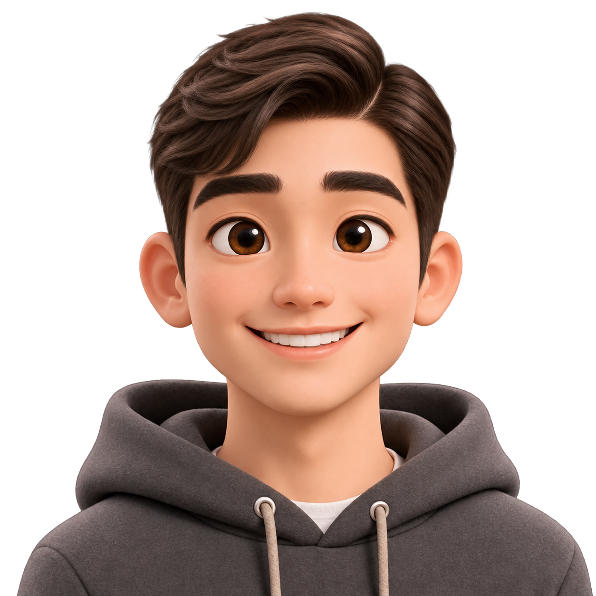
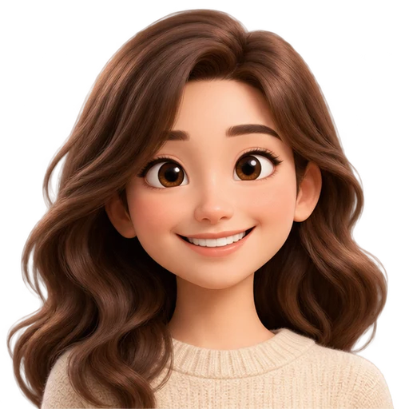
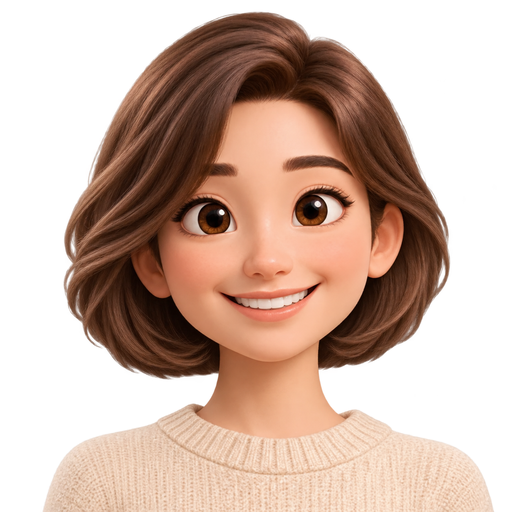
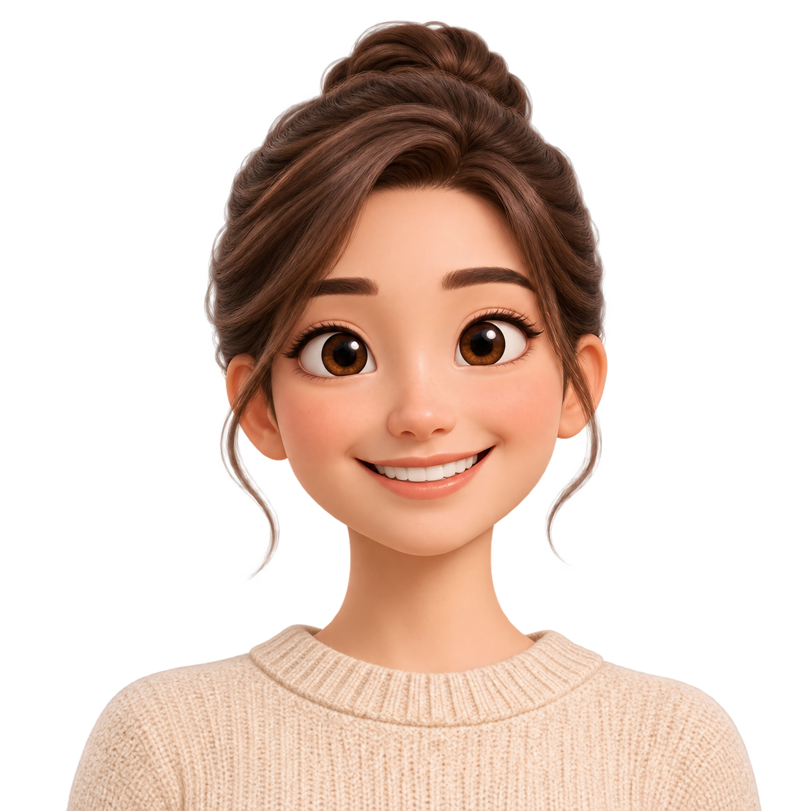

# 頭像 P2 美術候選審閱 — 2026-11-24

## 本輪成果與判定

以目前使用的男女角色原稿為參考，製作四個透明背景的完整肖像候選：
男生短髮、男生側分、女生鮑伯頭、女生盤髮。髮束、皮膚柔光和衣料質感
比程序化幾何試作更接近既有角色。這些檔案供外觀審閱，沒有加入正式素材目錄或編輯器。

**判定：可作為美術方向候選；尚未達到 v3 可互換圖層的整合條件。**

本批為 Imagegen 產生的完整 2D 肖像，不是可編輯的 3D 模型。
生成時雖要求保留臉部、服裝與座標，結果仍存在局部差異。
尤其女生盤髮的眼睛連線、頰部輪廓、頸部及領口與原稿有可見偏移；
不能直接沿用既有眼鏡圖層或宣稱只有頭髮像素改變。

## 男生：原稿與候選

| 既有原稿 | 短髮候選 | 側分候選 |
| --- | --- | --- |
|  |  |  |

短髮與側分的輪廓差異清楚，柔光、帽衫及髮束細節與原稿的風格接近。
兩張候選的臉部位置視覺上相近，仍不是像素對齊證據。
耳朵、五官與衣料有重新生成的細節，不應把完整肖像拆成不經驗證的差分貼圖。

## 女生：原稿與候選

| 既有原稿 | 鮑伯頭候選 | 盤髮候選 |
| --- | --- | --- |
|  |  |  |

鮑伯頭的髮量與彎曲髮尾可作為後續造型參考。
盤髮主要髮髻完整入框，但臉部、頸部及領口位置仍需重新校準。
兩張都重新生成了原先被長髮遮住的區域，不能視為原稿上完全獨立的髮型層。

## 已檢查的檔案性質

四張均為 1254 × 1254 RGBA PNG，alpha 範圍為 0–255，包含透明區域。
原始生成檔逐位元複製至此資料夾；未重新裁切、修補、縮放或取代原稿。
檔案雜湊與完整生成提示詞記錄於 [generation.json](generation.json)。

| 候選 | 檔案大小 |
| --- | ---: |
| 男生短髮 | 1,553,401 bytes |
| 男生側分 | 1,625,941 bytes |
| 女生鮑伯頭 | 1,746,990 bytes |
| 女生盤髮 | 1,408,469 bytes |

這些候選尚未符合 runtime 的 512 × 512 WebP、每檔最多 180 KiB 規格。
轉檔與縮圖只能處理尺寸，無法解決臉部漂移或圖層遮擋問題。
盤髮的主要不透明髮髻有頂部留白；邊緣仍需在深淺背景與小尺寸實際檢查。

## 目前功能與發布範圍

黑色／深棕色髮色、原有眼鏡開關、背景與陪伴動物沿用現有實作。
`AVATAR_LAYERED_PORTRAITS` 保持空白；程序化試作與本輪四張候選均未註冊。
既有使用者仍維持原稿外觀，選擇黑色時才使用明確的 `v2-tone` 設定。
本輪只增加審閱資料，沒有應用程式程式碼、資料庫、權限或部署設定變更。

## 驗證紀錄與限制

- 本輪重新執行的 35 項頭像測試全數通過，包含黑髮選擇、舊設定相容性、
  實際素材規格，以及 JSON 序列化後的設定正規化。
- 完整本地 `npm test` 亦為 185／185 通過，0 失敗、0 跳過。
- `b6af78d1993e0766617ffe8b76db95900575907b` 的
  [應用程式與資料庫 CI](https://github.com/ylee77ylee77-lang/servant-timeline/actions/runs/45380454258)
  和 [髮色素材檢查](https://github.com/ylee77ylee77-lang/servant-timeline/actions/runs/45380454421)
  均已通過。這些檢查不代表新美術候選已獲核可。
- 該提交的 Vercel preview 已確認 READY，正式站仍對應 main 的
  `755a35c83efe3f912e8807547c7565aa0ac07d25`。
- 遠端 preview 需要 Vercel 登入。建立臨時分享連結遭自動審查拒絕，
  原因是會擴大部署存取權；沒有重試其他分享或繞過途徑。
- 已在 repo 之外準備沿用真實元件的本地 QA 頁，沒有 AuthProvider、
  Supabase 或 API 寫入。其 TypeScript 檢查通過；瀏覽器安全政策阻止頁面檢視，
  因此不能宣稱互動、手機、帳號儲存／重開或視覺驗收通過。
  關閉臨時程序時亦觀察到 QA 頁的 Turbopack 編譯錯誤；此隔離測試頁不在 PR 內，
  該錯誤沒有被當成正式應用程式的建置結果。

## 下一個整合條件

在註冊新的髮型與鏡框選項之前，必須取得或完成固定相機、固定臉部座標的共用角色來源，
輸出相容的 face/body、前後髮及眼鏡圖層，並通過
[既有 P2 發布條件](../avatar-portrait-p2.md#release-gate-for-real-artwork)。
本輪較精緻的外觀候選可用來評估這個角色來源的美術方向，不能替代對齊和遮擋驗證。
PR 維持 Draft，待素材與實際手機流程通過審閱後再合併。

