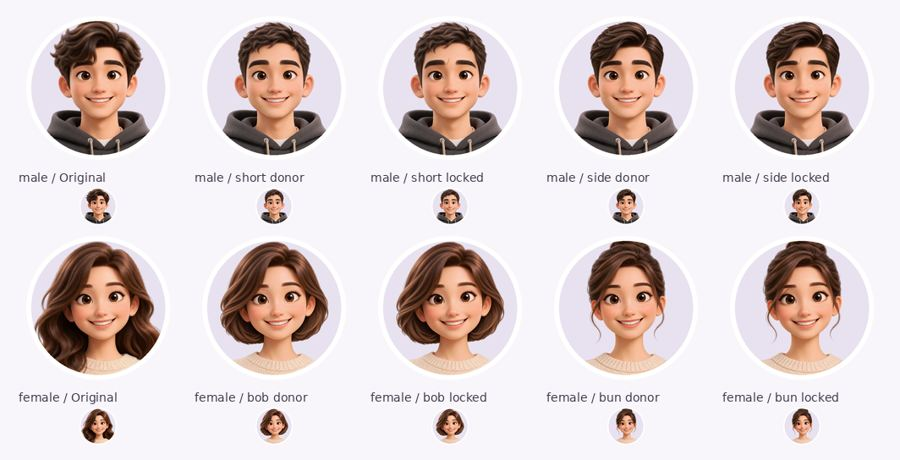

# P4 actual hairstyle artwork review

The generated comparison is from the successful GitHub Actions artwork proof at
`f36f44c72ce90c232d0f05cead6e3e4847b66701`, not an illustration of planned work. Left to right: original,
short aligned donor, short face-locked candidate, side/bun aligned donor,
side/bun face-locked candidate. Male row: short and side. Female row: bob and bun.

[Artwork run](https://github.com/ylee77ylee77-lang/servant-timeline/actions/runs/45522853544)
 · [Download complete review artifact](https://github.com/ylee77ylee77-lang/servant-timeline/actions/runs/45522853544/artifacts/14981795457) (sign in; expires after retention period)

| Candidate | Exact protected RGBA pixels | Changed protected pixels | WebP bytes | 180 KiB limit |
| --- | ---: | ---: | ---: | --- |
| male-short | 26192 | 0 | 178992 | pass |
| male-side | 26192 | 0 | 173534 | pass |
| female-bob | 26596 | 0 | 198406 | over |
| female-bun | 26596 | 0 | 171584 | pass |

The lossless encoded candidates preserve the same protected face pixels as
the pinned original. Their remaining hair, newly visible scalp, ears, neck,
clothing and outer silhouette are not pixel-identical to the original.
The bun donor required alignment; the final anchor offsets are in the machine
report. The bob trial exceeds the current per-source asset budget. Bun top
clearance and all hairlines/seams still require close inspection at full size.

These are four actual hairstyle candidates on the existing two character
identities, not four distinct face families. They are complete pre-rendered
source portraits, not approved interchangeable hair layers or new 3D meshes.
The permanent sheet is a compressed review copy; full 512px WebPs, lock masks,
and aligned donors are in the CI artifact. See
[measured report](avatar-character-art-review.json).
The runtime v3 catalog stays empty and the live app has no new hairstyle.
No production changes, no paid service, no additional app dependency.
