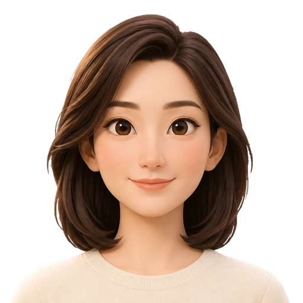

# P6: independent character master artwork — candidate only

Replaces the geometric face deformation proposal in PR #66. Two independently
generated characters, with no deformation of the released v2 source art.
The selected concept is separated into two 512×512 transparent WebP masters
using a traced silhouette and foreground segmentation, then uniformly scaled
and translated to approximate the existing portrait canvas. Local checks
confirmed decoded RGBA, transparent corners, opaque subject and 48/80/256px
circular previews. The male and female files are 46,420 and 50,524 bytes.

| Male B | Female B |
| --- | --- |
|  |  |

These are shaded 2D portrait candidates, not 3D rigs. Their original hair and
clothing are baked into each master. No claim is made that hair, eyes,
eyewear, or garments are interchangeable yet. Keep files outside public/,
leave the existing runtime family catalog unchanged and do not expose
unverified options. Do not register these under dormant family IDs.

## Remaining release gates
1. Prepare three identity-locked hairstyles per new character with aligned
   art, and source-specific hair/skin coverage that excludes the eyes, brows,
   mouth and clothing; verify color bleed and exact reset.
2. Fit the original, round, and square eyewear to the new eye landmarks.
3. Author individual neckline/hair cutouts and test every existing formal and
   casual outfit plus clothing color channels. Preserve the original outfit.
4. Verify the real shared renderer, full-size and 48/80/104/256px output,
   all five backgrounds and four companions, registration/profile editing,
   persistence/reopen, and legacy records. Use the existing editor and sticky
   preview; do not weaken the existing numeric rendering gates.
5. Visual review and authorized device acceptance before enabling the new
   choices or merging.

No app runtime, database, permissions, or production change in this trial.
The manifest pins the exact candidate files. The node tests verify file
integrity, WebP alpha metadata and dimensions; local decoded-image and visual
checks are separate, not an iPhone or browser-renderer test.

## Independent material candidates

Two RGB ownership masks are pinned under `materials/`. Each is traced for its
own source (not reused from v2), with narrow source-aware edge refinement
and explicit protected eye/brow/mouth and clothing landmarks. The old shared
renderer and old test gates are unchanged. Local Python color simulation
showed independent hair/skin tinting, exact preservation outside the active
mask, and 16 protected 3×3 patches. This simulation is not actual React SVG
rendering. The existing Node verification now additionally exercises the actual
AvatarMaterialFilter on these two candidate sources in 12 cases and exports
`independent-material-review.png`. CI result is pending at commit time.

Visual blocker: deep-skin samples still show pale borders around some eyes
and lips. Keep this candidate-only; do not register in runtime until refined
and approved. The 2D masters still need identity-locked hairstyle assets,
source-specific eyewear and outfit fitting, and browser/device validation.
No profile fields, runtime UI, or production behavior change.

## Periocular and lip-edge refinement

The previous 12-case SVG filter CI (#275) passed, but visual review still
showed pale original-tone borders. The new source-aware refinement helper
uses tight feature envelopes, warm skin evidence, protected eye interiors,
and graded lip-edge ownership for these two closed-mouth masters. The
original masks remain pinned, the hair channel is bit-identical, and no
ownership outside the local envelopes is changed. The existing 16 protected
3x3 patches and all existing renderer thresholds remain intact.

Local Sharp generation restored skin coverage on 318 eye-edge and 1,011
lip-edge pixels (male), 434 and 1,467 respectively (female). Local offline
color simulation preserved unselected pixels and source alpha and showed
less conspicuous lip outlines. Fine eye-edge variation and extreme-tone
artistry still need visual approval; this is not an iPhone test. Lip-edge
tissue may now tint partially while central protected samples remain exact.

The CI verifier keeps the original 12 cases as controls and adds 12 cases
for the deterministically refined masks. It saves both comparison sheets and
regenerated masks as review artifacts. New CI is pending. Runtime remains
unchanged; hairstyle, eyewear and garment alignment are not implemented.

## Independent hairstyle candidates

The preceding material refinement CI #276 passed (24 candidate SVG tint
cases plus the existing application checks). Two additional generated donor
hairstyles per identity have now been aligned to the original master artboard.
The source interior face is copied losslessly; the transition is composited
outside that locked region. Four new 512px transparent lossless WebP files
are pinned under hairstyles/, with two binary face-lock masks and a manifest.
Local decoded comparison proved 34,298 exact RGBA pixels per male candidate
and 31,972 per female candidate (132,540 total). Each candidate is below the
180 KiB source budget. The new CI proof checks these same exact pixels,
source hashes, alpha, size and headroom and exports a circular contact sheet.

These are complete shaded 2D portrait candidates, not interchangeable hair
layers. The locked face interior excludes the hairline, outer contour and
neck, so the test does not prove every facial pixel or clothing pixel is
unchanged. The female bun neck/hair transition was refined; seams, silhouette,
and distinctiveness of the side-part/bob styles still require visual review.
Each new hairstyle needs its own source-specific tint mask; existing master
masks must not be reused unchanged. Eyewear and garment alignment and actual
UI integration remain pending. New CI is not yet confirmed. No changes to
runtime registration, database, authorization, or production.

## Per-hairstyle material ownership

CI #277 passed the existing 24 candidate tint cases, four locked hairstyle
cases, application checks and database authorization. Each of the four
new hairstyles now has its own pinned RGB mask under hairstyle-materials/.
The source-specific traced hair and skin shapes are refined only in a narrow
boundary band. The exact refined master ownership is retained within the
binary facial lock and blended outside it; no color ownership is assigned
to fully transparent source pixels. The reproducible candidate builder is
scripts/build-avatar-hairstyle-candidate-masks.mjs. Local decoding and color
simulation verified all four masks, 132,540 locked ownership pixels and 32
protected 3x3 patches, independent tinting and unchanged source alpha. Each
mask is below 24 KiB. The CI proof regenerates the masks, compares decoded
ownership against the pinned PNGs and adds 24 actual AvatarMaterialFilter
cases, leaving all previous checks in place. It produces
independent-hairstyle-material-review.png. The new CI has not yet completed.

Local contact-sheet review still shows some residual original color at fine
bun hair strands and other edges at extreme light hair tones. This is a
candidate stage, not visual approval or an actual interactive avatar. The
sources still need eyewear and garment alignment, runtime registration,
shared-renderer tests and device acceptance. No production or database change.

## Candidate eyewear fitting

CI #278 passed the preceding four source-specific hairstyle masks and 48
candidate material cases, production build and database authorization. The
new candidate geometry fits the original-style (recreated vector), round and
square frames to the two B-face eye landmarks. Each hairstyle uses its own
hair coverage to occlude the frame; the existing AvatarEyewear component's
stroke, gradient, and frame color are reused. No eyewear is baked into the
portrait, and the three choices can be removed without changing the source.

Local CairoSVG/Pillow compositing of the same frame paths and shading checked
30 cases (six hairstyles, three original frame styles plus gold round and
blue square). All 60 pupil patches remained clear, fully covered hair masked
the frame, and source alpha did not change. This is a local path preview,
not the React component's raster result. The CI verifier renders the real
AvatarEyewear component in the established portrait bounds: 72 combinations
across 48/80/104/256px, 18 full-source checks for eye patches, hair occlusion
and transparency, and 18 combined hair/skin/frame tint cases. It exports
independent-eyewear-review.png. The new CI results are pending. The original
frame style is a fitted vector approximation, not the original baked raster.

The new hair and eye components are still candidates; visual acceptance,
full formal/casual outfit alignment, application catalog and shared renderer
integration, persistence and iPhone testing remain necessary. Existing
runtime, main, and database are unchanged.

## Candidate garment fitting

CI #279 passed all preceding candidate eyewear checks (72 sizes, 18
full-source protection checks and 18 combined tint checks). The new fit
module aligns the existing ten garment artworks to the six candidate
portraits. Only the garment is transformed; the face is never warped. The
optional artwork fit retains the released default path and transform when
omitted. Source-specific head and hair-tip cutouts preserve the complete
upper portrait. An expanded fabric field is composited only into the
source silhouette outside that cutout, preserving the source alpha.

Local Pillow/CairoSVG diagnostics confirmed the six cutout shapes, exact
preservation above source y=390 and unchanged alpha. The diagnostic uses a
plain fill, not the actual garment artwork. The new offline CI harness
renders the actual React AvatarFormalOutfitArtwork, checks 30 full-source
fits, 120 display-size combinations (72 formal, 48 casual), 45 individual
clothing/lining/tie color trials and six combined person/eyewear/outfit
color trials; it exports independent-outfit-review.png. The CI results and
actual garment visual acceptance are pending. The neckline fit intentionally
replaces part of the lower neck where a higher collar would sit. The
source silhouette retains any existing antialiased/soft donor edges.

Exact raster blending here is a QA proof, not the browser implementation.
Runtime registration and a shared renderer composition that matches this
proof still need implementation and device testing. The existing garment
artwork default is unchanged; no new portrait is enabled or persisted, and
no database or main branch change is included.

## Shared application integration (draft)

CI #280 passed the preceding offline garment proof. An explicit versioned
independentPortrait selection now resolves six allowlisted b1 assets. Dormant
portraitFamily/portraitVersion/hair fields do not activate the new art. The
same AvatarEditor and AvatarRenderer are used for registration, profile,
roster and communication UI. Both existing profile API entry points already
normalize and persist avatar_config; no migration or permission change is
needed. The original face option removes only the b1 selection. The b1 frame
style is stored independently so legacy frame style is not overwritten.

The fitted garment is composited below the source portrait with two masks.
For source alpha a and head retention k, garment alpha is a(1-k)/(1-ak)
(with zero when k=1). The two white alpha masks preserve the source silhouette
when composited, with at most half an alpha step of quantization error. The
six portraits share four fit-mask pairs. Existing garment paths, layers and
legacy renderer behavior are unchanged when the new selection is absent.

The draft registers real public assets and exercises the actual shared
renderer in 120 outfit/size combinations. The new Node tests pin hashes,
validate the mask composition formula, check same-style selection, rejection
of malformed data, and JSON round trips. New CI, actual browser rendering,
visual approval, registration and authenticated save/reopen on a preview
site, and iPhone acceptance remain required before merge. Known residual
hair-strand and feature-edge tint issues remain subject to visual review.
