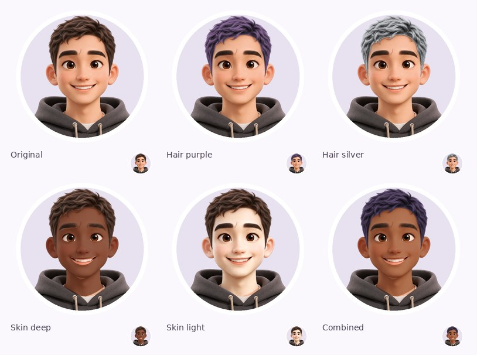
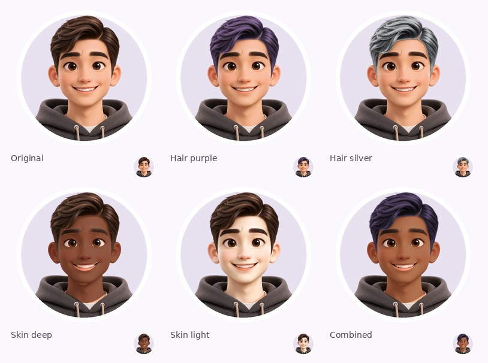
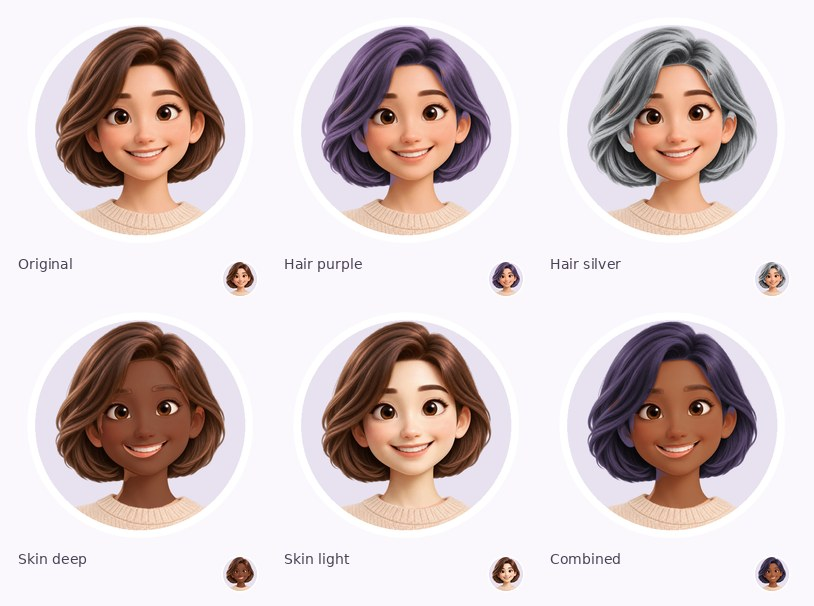
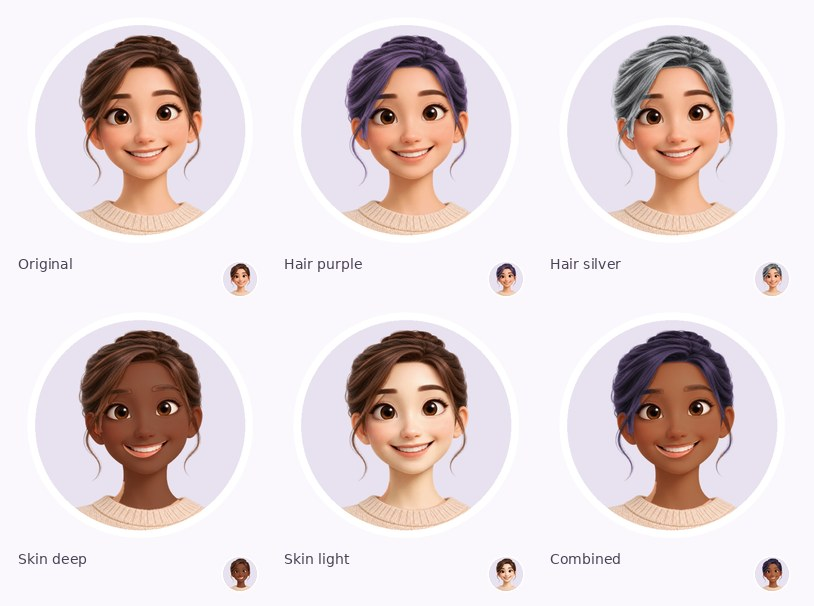

# P4 hairstyle integration preview

Four actual source-locked 512px WebP illustrations and their matched hair/skin RGB coverage are registered in this branch. The reviewed authoring job is [45529616520](https://github.com/ylee77ylee77-lang/servant-timeline/actions/runs/45529616520), commit `e107ce0327c12017df77d3a918748a14230c04cf`. All four source images are below 180 KiB; all four masks are below 15 KiB. The bun's upper silhouette was re-fitted; bob compression changes non-identity RGB by at most 1 level. All protected identity RGBA pixels remain exact. The review sheets below are actual offline transfer outputs; the shared renderer verification is separate.

## 俐落短髮

## 經典側分

## 鮑伯短髮

## 自然盤髮

The existing two identities gain two optional styles each. The new optional hairstyleVariant ID is explicit and gender-validated; legacy hair/black source settings are not rewritten. Original choice restores the saved legacy source. One full source and one coverage map per style, not per color or frame. Existing material transfer curves drive hair and skin, and existing independent round/square glasses remain available. For new portraits only, the original-style frame is reconstructed from its traced rings and clear lens geometry. Hair occlusion uses the source-specific red coverage channel; the original baked classic source stays unchanged. Existing preview, backgrounds, pets, roles, auth and storage workflow remain unchanged.

The four-family v3 layered catalog remains empty: these are complete 2D source illustrations with separately recolorable material coverage, not new faces or interchangeable 3D mesh hair. Registration is in a draft development branch for visual review, not an assertion of final art or iPhone approval. No schema changes or new runtime dependencies. The remaining new face families are a separate art task.

Run existing lint, tests, build, and material renderer verification. Additional shared-renderer review covers 4 styles x 4 sizes x 3 frame choices, with original/hair/skin/combined variants. The latest app CI and iPhone save/reopen are release gates.
