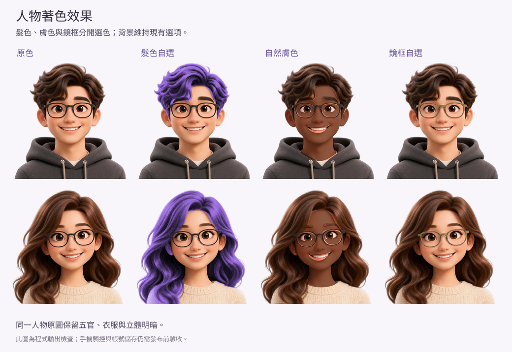
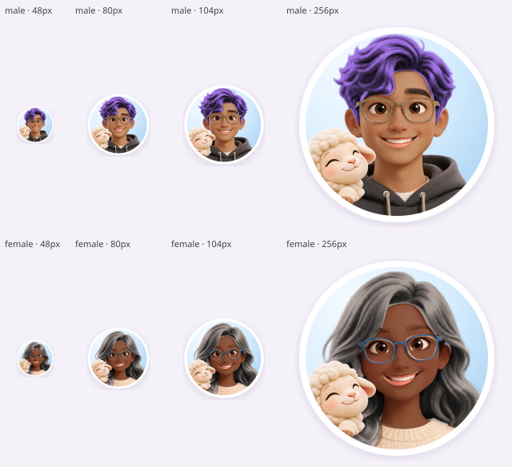

# Avatar P2 — continuous color selection



## Implemented behavior on the feature branch

Registration and profile settings share `AvatarEditor`, which now mounts the
same three collapsed color controls next to the existing person/glasses choices:

- Hair and frame: a continuous 360-degree HSV disc and brightness slider.
- Skin: a bounded continuous warm-tone disc and brightness slider, including
  deeper tones. This is an artistic palette, not a skin classification system.
- Only one color disc opens at a time. Pointer dragging, arrow keys, and native
  sliders under「精細調整」are available. The frame control appears with glasses.
- Selection updates the existing local avatar draft. Existing registration or
  explicit profile save submits it; dragging never calls a color/AI service.
- Each channel can return to its original source color independently. Opening
  a picker does not change a saved color. Local HSV coordinates retain hue when
  brightness reaches zero; saved values remain exact RGB.
- Switching base character preserves the chosen colors. Hiding glasses retains
  the chosen frame color. Icon/name modes retain preferences without rendering
  the portrait.「重新建立」continues to create a fresh default avatar.

The original five backgrounds and four optional animals are unchanged. Color
selection does not create a multicolor gradient on the hair: the gradient disc
selects one material color, while the original light and shade remain visible.

## Rendering and source ownership

`AvatarRenderer` remains the common renderer used by the editor, profile and
communication avatars. It applies `AvatarMaterialFilter` only when explicit
color overrides exist and the exact portrait source is registered. Old avatars
without those fields render their original images without a new filter.

The four original v2 portraits and their aligned black-hair derivatives are the
only supported sources. A saved black-hair portrait keeps its exact source while
custom colors are applied, avoiding a brown/black codec or hairline transition.
Reset removes the override; it never substitutes a newly generated portrait.
The future v3 hairstyle catalog remains empty and unmodified.

This implementation recolors the existing 2D raster artwork. It does not recover
3D meshes, diffuse/specular passes or physically accurate relighting. The future
four face families and interchangeable hairstyles still require approved artwork.

The coverage contract uses the same 512px source artboard and the renderer's
existing portrait bounds. Red, green and blue encode hair, skin and frame
ownership in four small PNG maps. Static SVG contours are maintained in
`avatar-materials.ts`, `avatar-frame-paths.ts` and `avatar-feature-paths.ts`.
The generator refines only narrow brow/lash envelopes and the traced hairline
using the pinned original pixels. It does not globally classify the portrait.
Eyes, teeth, lips, clothing and lens interiors stay outside the relevant tint.

Hair and frames use the source luminance to retain strand and frame shading;
skin scales its original RGB channels to retain warm color and blush variation.
A source-luminance guard protects light reflections near the frame. The selected
RGB is a color reference, so shaded rendered pixels are not a flat copy of it.

The filter computes the sum of selected coverage, removes that coverage from
`SourceGraphic` once, and adds the separately tinted contributions. It does not
stack a second portrait over the original; that would increase partial edge
opacity. RGB ownership never exceeds one pixel. All primitives use sRGB.
The composition follows [SVG filter arithmetic](https://www.w3.org/TR/filter-effects-1/#feCompositeElement).
The byte-level renderer check allows at most 1/255 alpha rounding difference.

Coverage PNGs are immutable source-specific app assets under
`public/avatar/materials/v1/`. Each is below 24 KiB. They load as normal static
assets when needed; choosing another color changes filter values locally.
No new application dependency, paid provider, runtime AI call, API endpoint,
credential or database migration is introduced.

## Persistence and backwards compatibility

`AvatarConfig.materialColors` is optional:

```json
{"materialColors":{"hair":"#654539","skin":"#BC855E","frame":"#B88E55"}}
```

The shared `normalizeAvatarConfig` accepts only own properties named `hair`,
`skin` and `frame`, with exactly six hexadecimal digits. It uppercases valid
values and omits invalid/empty fields. The skin gamut is bounded in the UI;
normalization validates the RGB representation without reprojecting a saved
skin color through the disc and accidentally changing its bytes.

Existing authenticated registration/profile writes and communication reads
already use this normalizer and carry the complete JSONB config. Authorization
and write timing are unchanged. Unit tests verify JSON roundtrip, legacy
identity, prototype/invalid input rejection, independent reset, hidden frame
preferences and exact black-source preservation. These tests do not replace an
actual signed-in save/reopen test.

## Reproducible checks

```sh
npm test
npm run type-check
node --experimental-strip-types scripts/build-avatar-material-masks.mjs --check
node --experimental-strip-types scripts/verify-avatar-material-rendering.mjs
npm run build
```

Run the mask generator without `--check` after an intentional contour change.
It pins all eight portrait SHA-256 values and checks regenerated pixels against
the committed PNG maps. Replacing source artwork requires renewed coverage review.

The rendering script compiles the actual React filter with the installed
TypeScript compiler and rasterizes it with Sharp/librsvg. Eight source portraits
are checked against eight independent/combined color cases. Checks cover alpha,
unchanged pixels outside selected coverage, eyes/teeth/clothing patches, lens
holes, and adjacent skin that must actually change. Reports and comparison
images are developer review output outside `public/`; CI uploads them for review.

The actual shared `AvatarRenderer` is also rendered at 48/80/104/256px, using
its real portrait bounds, round frame and companion image. These checks catch
filter-placement errors that an isolated 512px material test would miss.



The earlier procedural 3D proof (`prototype-avatar-materials.py`) remains a
separate authoring experiment. Its geometry and masks are not registered in the
application, and its success is not used as evidence for the v2 color renderer.

## Release review

Source and raster verification can establish consistent geometry and isolated
color changes. They do not establish Safari behavior, touch performance or
account persistence in a live session. Review light/deep skin, black/white and
bright hair, and bright frames at full size and thumbnail size. The fine warm
hairline transition is baked into the source and still needs visual approval.

Before merging the Draft PR: review the rendered artwork; test registration,
profile editing, cancel/reset, explicit save and reopen in an authorized session;
and inspect iPhone PWA touch behavior and communication avatars. Keep production
on main until those checks and the production release review are complete.
